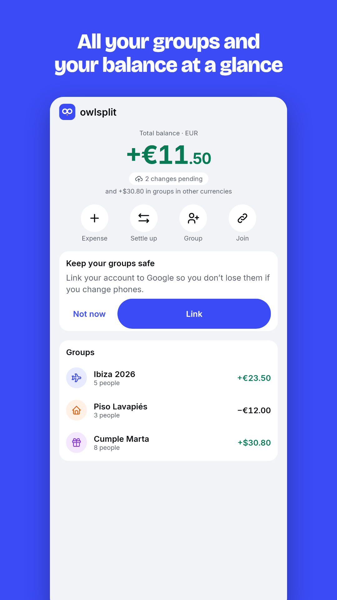
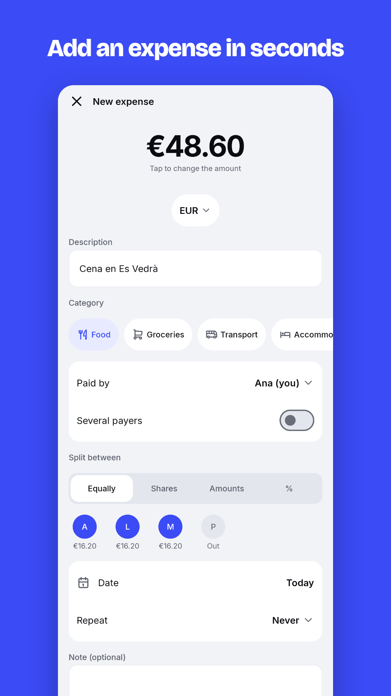
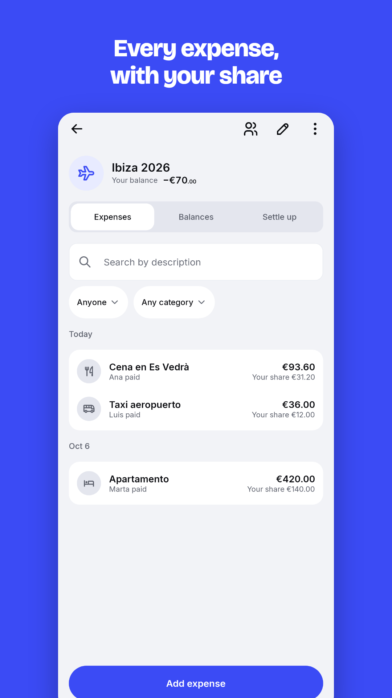
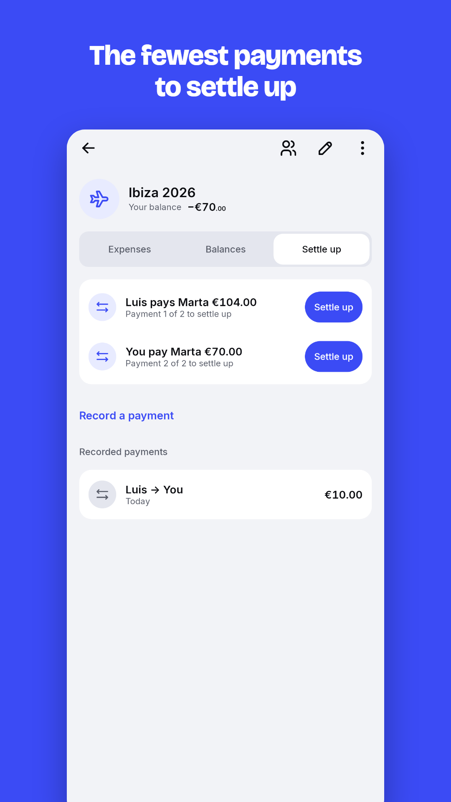

# Owlsplit

[](https://github.com/Sebas1705/Owlsplit/actions/workflows/ci.yml)
[](https://github.com/Sebas1705/Owlsplit/releases/latest)
[](LICENSE)

Android and iOS app for tracking shared group expenses (trips, flats, dinners, gifts): who paid what, how much each person owes, and how to settle up with the fewest payments. It works offline and syncs across all members.

**Download:** [owlsplit.web.app](https://owlsplit.web.app) (Android APK) · [GitHub Releases](https://github.com/Sebas1705/Owlsplit/releases/latest) · Google Play closed testing.

<p align="center">
  
  
  
  
</p>

Inspired by Settle Up, with a polished design (clean fintech style) and more features ahead: one-tap settle-up, recurring expenses, budgets and statistics, and receipt scanning.

> **Status:** public beta (P1–P15 done). See the [plans](docs/plans/README.md).

Code and docs are in English; the app UI is in Spanish and English.

## Documentation

| Document | Contents |
|---|---|
| [Core design (MVP)](docs/designs/2026-10-07-owlsplit-core-design.md) | Full spec: scope, architecture, UX, errors, testing, CI and acceptance criteria |
| [Roadmap](docs/ROADMAP.md) | The five subprojects and their order |
| [Domain](docs/DOMAIN.md) | Entities, money rules, splitting, currencies, balances and debt simplification |
| [Sync](docs/SYNC.md) | Local-first engine: outbox, listeners, conflicts and deletions |
| [Firebase](docs/FIREBASE.md) | Projects, collections, rules, authentication and account deletion |
| [Design system](docs/DESIGN_SYSTEM.md) | Tokens, typography, components, motion and tone |
| [Brand](docs/BRAND.md) | Logo, colors and icons from `brand/tokens.json` (app, web and icons) |
| [Decisions (ADR)](docs/adr/README.md) | Why each piece was chosen and what was ruled out |
| [Approved mockup](docs/mockups/owlsplit-fintech-v3.html) | Home, group and expense editor |

## Stack

Kotlin Multiplatform · Compose Multiplatform · SQLDelight · Koin · Ktor · Firebase (Auth, Firestore) via GitLive, on top of the Templetry `kmp/modular-features` template.

## Development

Requirements: JDK 21 and Android SDK (platform 36). iOS only builds on macOS.

```bash
export JAVA_HOME="/c/Users/sebss/.jdks/jdk-21.0.12.1+1"
export ANDROID_HOME="/c/Users/sebss/Android/sdk"
scripts/doppler-sync-local.sh                   # Firebase configuration (Doppler)
./gradlew :composeApp:installDebug         # debug app (es.sebas1705.owlsplit.debug)
./gradlew build                            # tests, detekt, lint and builds
./gradlew koverHtmlReportUnitTests         # coverage report: build/reports/kover/htmlUnitTests/index.html
```

Unit-test line coverage is 79.6 % (Kover, all library modules, measured 2026-10-25). CI publishes the report on every run and fails if it drops below 75 % (`koverVerifyUnitTests`).

Module structure in [MODULE_MAP.md](MODULE_MAP.md); implementation plans in [docs/plans](docs/plans/README.md); Firebase in [docs/FIREBASE.md](docs/FIREBASE.md); tester distribution (Firebase App Distribution) and versioning in [docs/RELEASE.md](docs/RELEASE.md); MVP acceptance criteria in [docs/ACCEPTANCE.md](docs/ACCEPTANCE.md).

iOS: the Xcode project is generated with XcodeGen (`cd iosApp && xcodegen generate`, on a Mac); CI builds the app for the simulator on every PR.

## License

[MIT](LICENSE). The license covers the code; the Owlsplit name and logo are not included, so a copy or derivative must use a different name.
